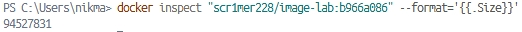
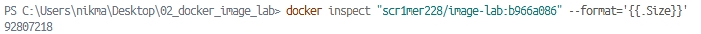
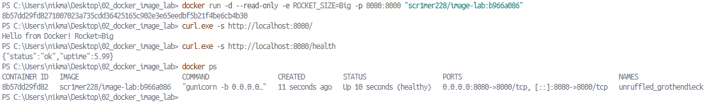

# Отчет по лабораторной 2.
**Цель работы:** собрать production-образ для мини-сервиса на Flask так, чтобы он был:
- маленький (**< 150 MB**),
- безопасный (**не root**),
- с **HEALTHCHECK**,
- корректно завершался по **SIGTERM**,
- умел работать при `--read-only`,
- принимал конфиг через переменные окружения **без пересборки**.
---
## Вывод docker history

```bash
IMAGE          CREATED        CREATED BY                                      SIZE      COMMENT
c31101a836b5   22 hours ago   CMD ["gunicorn" "-b" "0.0.0.0:8000" "--grace…   0B        buildkit.dockerfile.v0
<missing>      22 hours ago   EXPOSE [8000/tcp]                               0B        buildkit.dockerfile.v0
<missing>      22 hours ago   HEALTHCHECK {Test:[CMD-SHELL python3 -c "imp…   0B        buildkit.dockerfile.v0
<missing>      22 hours ago   USER appuser                                    0B        buildkit.dockerfile.v0
<missing>      22 hours ago   COPY --chown=appuser:appuser app/ . # buildk…   12.3kB    buildkit.dockerfile.v0
<missing>      22 hours ago   RUN |2 LAB_LOGIN=scr1mer228 LAB_TOKEN=b966a0…   7.62MB    buildkit.dockerfile.v0
<missing>      3 days ago     RUN |2 LAB_LOGIN=scr1mer228 LAB_TOKEN=b966a0…   41kB      buildkit.dockerfile.v0
<missing>      5 days ago     WORKDIR /app                                    8.19kB    buildkit.dockerfile.v0
<missing>      5 days ago     ENV PYTHONUNBUFFERED=1                          0B        buildkit.dockerfile.v0
<missing>      5 days ago     ENV PYTHONDONTWRITEBYTECODE=1                   0B        buildkit.dockerfile.v0
<missing>      5 days ago     ENV LAB_TOKEN=b966a086718bb9e6d20f4a1927f4bd…   0B        buildkit.dockerfile.v0
<missing>      5 days ago     ENV LAB_LOGIN=scr1mer228                        0B        buildkit.dockerfile.v0
<missing>      5 days ago     LABEL org.lab.token=b966a086718bb9e6d20f4a19…   0B        buildkit.dockerfile.v0
<missing>      5 days ago     LABEL org.lab.login=scr1mer228                  0B        buildkit.dockerfile.v0
<missing>      5 days ago     ARG LAB_TOKEN=b966a086718bb9e6d20f4a1927f4bd…   0B        buildkit.dockerfile.v0
<missing>      5 days ago     ARG LAB_LOGIN=scr1mer228                        0B        buildkit.dockerfile.v0
<missing>      2 weeks ago    CMD ["python3"]                                 0B        buildkit.dockerfile.v0
<missing>      2 weeks ago    RUN /bin/sh -c set -eux;  for src in idle3 p…   16.4kB    buildkit.dockerfile.v0
<missing>      2 weeks ago    RUN /bin/sh -c set -eux;   apk add --no-cach…   50.4MB    buildkit.dockerfile.v0
<missing>      2 weeks ago    ENV PYTHON_SHA256=c2c4321961fab0fb999d66e0ce…   0B        buildkit.dockerfile.v0
<missing>      2 weeks ago    ENV PYTHON_VERSION=3.12.15                      0B        buildkit.dockerfile.v0
<missing>      2 weeks ago    ENV GPG_KEY=7169605F62C751356D054A26A821E680…   0B        buildkit.dockerfile.v0
<missing>      2 weeks ago    RUN /bin/sh -c set -eux;  apk add --no-cache…   2.83MB    buildkit.dockerfile.v0
<missing>      2 weeks ago    ENV LANG=C.UTF-8                                0B        buildkit.dockerfile.v0
<missing>      2 weeks ago    ENV PATH=/usr/local/bin:/usr/local/sbin:/usr…   0B        buildkit.dockerfile.v0
<missing>      4 weeks ago    CMD ["/bin/sh"]                                 0B        buildkit.dockerfile.v0
<missing>      4 weeks ago    ADD alpine-minirootfs-3.24.2-x86_64.tar.gz /…   9.08MB    buildkit.dockerfile.v0
```
---

## Плюсы моей сборки
- **Multi-stage:** зависимости собираются в builder-стадии в wheel-пакеты(не нужно компилировать заново), а в финальный образ попадают только готовые wheel и runtime, без компиляторов, кэша `pip` и лишних build-зависимостей.

- **Размер:** помимо того, что мы не тянем зависимости из build, я использую более легковесный базовый слой: python:3.12-alpine

- **Безопасность:** Приложение запускается не от root, а под отдельным пользователем `appuser` с `UID 10001`, а файлы копируются с `--chown` (задает владельца сразу в момент копирования).

- **Process manager:** используется Gunicorn с `--graceful-timeout`, что даёт production-режим и корректное завершение по `SIGTERM`.

- **HEALTHCHECK:** проверяет `GET /health` через встроенный `urllib`.

- Переменная `ROCKET_SIZE` читается из окружения, поэтому меняется без пересборки.

- **Работа в режиме ro:** `--worker-tmp-dir /dev/shm` (чтобы воркер смог писать временные файлы без проблем с режимом)
---


## Изменения 18.10.2026
Команды:
```bash
COPY --chown=appuser:appuser --from=builder /wheels /wheels
COPY --chown=appuser:appuser requirements.txt .
RUN pip install --no-index --find-links=/wheels -r requirements.txt
```
были заменены на:
```bash
RUN --mount=type=bind,from=builder,source=/wheels,target=/wheels \
    --mount=type=bind,source=requirements.txt,target=requirements.txt \
    pip install --no-index --find-links=/wheels -r requirements.txt
```
---

## Пояснения:

### **Изменения:**
В финальном образе остается каталог `/wheels` с установочными пакетами, которые после установки зависимостей не нужны. `RUN --mount` позволяет создавать точки монтирования файловой системы, к которым может получить доступ сборка.
`RUN --mount=type=bind` этот тип монтирования позволяет привязывать файлы или каталоги к контейнеру сборки. Сами смонтированные файлы не попадают в финальный слой собранного образа. Они существуют только в момент выполнения команды `RUN`.
Размер финального образа изменился с 94527831 байт на 92807218 байт.




### **Как слои Docker влияют на размер:**
Docker образ состоит из слоев. Каждая инструкция (`RUN`, `COPY`, `ADD`) создает новый слой. Каждый слой - это набор изменений относительно предыдущего слоя. Если добавить файл в одном слое и удалить его в другом,  то файл всё равно останется в истории предыдущего слоя и будет занимать место в итоговом образе. Изменения, проведенные выше, позволяют избежать "файлов-призраков" в итоговом образе.

### **Итоговый образ занимает (в байтах):**
  
  То-есть менее, чем 150 Мб.

### **Работа контейнера в режиме `ro`:**


### **Зачем нужен `--worker-tmp-dir /dev/shm`:**
По умолчанию `Gunicorn` использует механизм heartbeat для проверки того, жив ли рабочий процесс.
Он постоянно создает и обновляет временные файлы в системной директории `/tmp`. Когда мы запускам контейнер с флагом `--read-only`, вся файловая система становится доступна только для чтения. В этом случае Gunicorn упадет с ошибкой инициализации или воркеры просто будут постоянно перезапускаться, так как главный процесс не сможет проверить их статус.
Для избегания таких проблем мы меняем директорию временных файлов на `/dev/shm`.
Директория `/dev/shm` по умолчанию является shared memory (tmpfs) и доступна на запись даже в read-only контейнерах.

### **Зачем `pip wheel` на этапе `builder`:**
Wheel-файлы (с расширением `.whl`) - это предварительно собранные пакеты Python, которые значительно упрощают процесс установки библиотек. По сути, это архивы, содержащие уже скомпилированный код, метаданные и все необходимые ресурсы для быстрой установки. Команда `pip wheel` используется для сборки wheel-файлов (.whl).
Она берет исходный код пакета и упаковывает его в стандартный zip-архив с расширением `.whl` .Если пакет содержит код на `C`, `C++` или `Rust`, команда компилирует его один раз в готовый к установке файл, вместо того чтобы каждый раз компилировать пакет заново. В финальный образ мы копируем только эти готовые архивы и устанавливаем их, не требуя дополнительных компиляторов.

### **Как работает установка с `--no-index`:**
Флаг `--no-index` в менеджере пакетов `pip` запрещает обращаться к внешним репозиториям и индексам (включая основной каталог `PyPI`). В связке с `--find-links=/wheels` мы указываем `pip` искать пакеты только в заранее скачанных архивах (например `.whl`) на самом устройстве. Это гарантирует, что при сборке не будут скачаны лишние или несовместимые версии, а также позволяет собирать образ в изолированных сетях.

### **Как Gunicorn обрабатывает `SIGTERM`:**
Gunicorn обрабатывает сигнал `SIGTERM`, запуская процесс корректного завершения работы (Graceful Shutdown).
1. Главный процесс Gunicorn получает сигнал `SIGTERM`. Далее закрывает слушающие сокеты, чтобы новые входящие соединения больше не поступали.
2. После чего отправляет воркерам сигнал `SIGTERM` (или внутреннюю команду), сообщая им, что пора завершаться.
3. Воркеры продолжают обрабатывать те запросы, которые уже были приняты в момент прихода сигнала.
4. Главный процесс ждет выполнения всех текущих запросов в пределах заданного тайм-аута.
5. Если воркеры не успевают обработать текущие запросы за отведённое время тайм-аута, главный процесс отправляет им сигнал `SIGKILL`, принудительно завершая их работу.
6.  После закрытия всех воркеров главный процесс Gunicorn завершает свою работу с кодом 0.
В нашем случае в app.py уже имеется обработчик sigterm, но в связке с Gunicorn мастер-процесс перехватывает сигнал раньше.
