# Отчёт по 3 лабораторной работе.
## Цель работы
* Научиться запускать контейнеры с параметрами (имя, порты, связи).
* Закрепить работу с устаревшим `--link` (для понимания исторического контекста).
* Описать стек из 2 сервисов в `docker-compose.yml`.
* Масштабировать сервисы средствами Docker Compose и корректно завершать стек.
---


## Ход выполнения

### Часть 1. Запуск вручную (контейнеры `docker run`)
Запускаем контейнер на образе `Redis` c именем `redis`:
```bash
docker run -d --name redis -p 6379:6379 redis
```


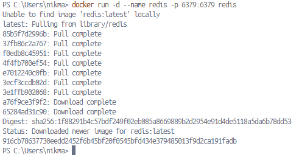</img>


Проверяем `docker ps`:


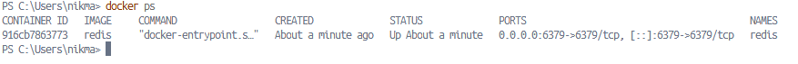</img>


Запускаем контейнер с `rocketcounter`, связанный с Redis и опубликованный на порту `8085`, из образа `rotorocloud/rocket-counter`:
```bash
docker run -d -p 8085:5000 --link redis:redis --name rc rotorocloud/rocket-counter
```


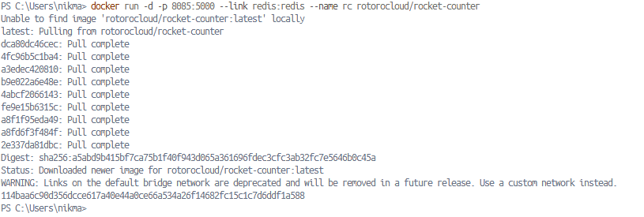</img>


Проверяем `docker ps`, кликабельность кнопки `GET A ROCKET` и обновление счётчика:


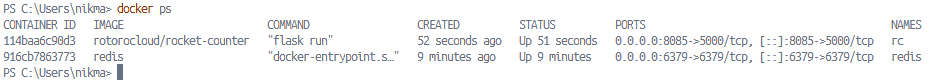</img>
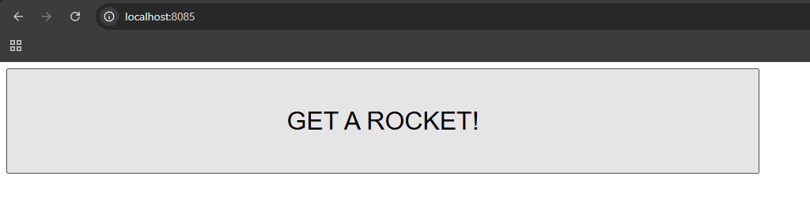</img>
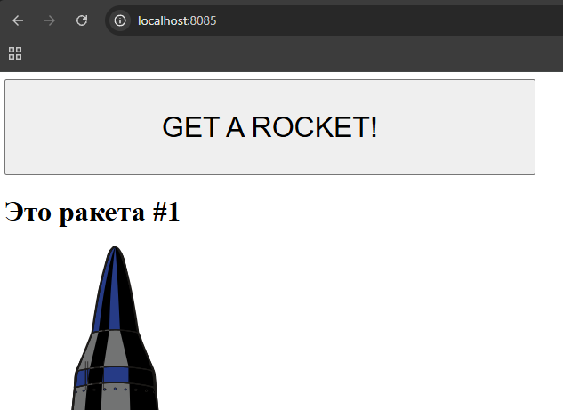</img>


Удаляем контейнеры `redis` и `rocketcounter`.

---


### Часть 2. Описание стека в `docker-compose.yml`
Создаем каталог `/root/rocketcounter` и переходим в него.
Создаем файл `docker-compose.yml` со всеми необходимыми требованиями:
```bash
version 2

services:
  redis:
    image: redis

  rocketcounter:
    image: rotorocloud/rocket-counter
    ports:
      - "8085:5000"
    depends_on:
      - redis

```

Запускаем стэк:
```bash
docker compose up -d
```

Проверяем:
```bash

docker compose ps

```


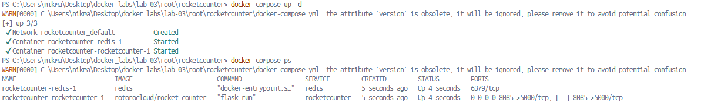</img>


Можем наблюдать сообщение:
```bash
WARN[0000] C:\Users\nikma\Desktop\docker_labs\lab-03\root\rocketcounter\docker-compose.yml: the attribute `version` is obsolete, it will be ignored, please remove it to avoid potential confusion
```
Что означает, что мы можем не указывать версию docker compose, так как современная версия больше не использует и не учитывает параметр `version` в начале файла `docker-compose.yml`.

---


### Часть 3. Масштабирование приложения
Изменим публикацию портов на динамическую (эфемерные порты для каждого экземпляра):
```bash
services:
  redis:
    image: redis

  rocketcounter:
    image: rotorocloud/rocket-counter
    ports:
      - "0:5000" 
    depends_on:
      - redis
```

Применим изменения и сразу создадим два экземпляра `rocketcounter` на разных хост-портах:
```bash
docker compose up -d --scale rocketcounter=2
```


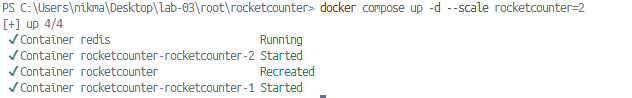</img>


Проверим docker compose ps:


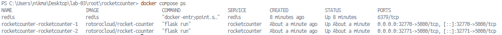</img>
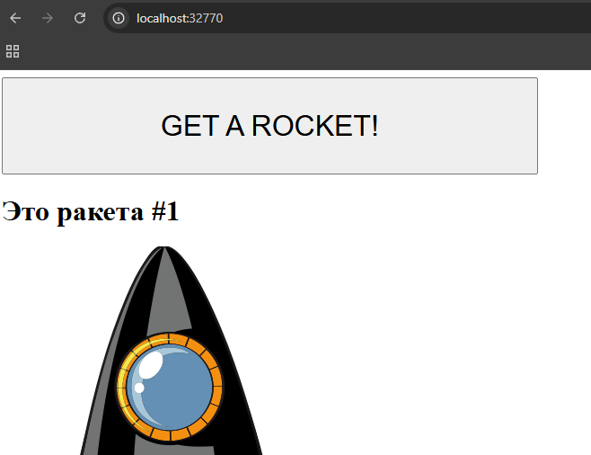</img>
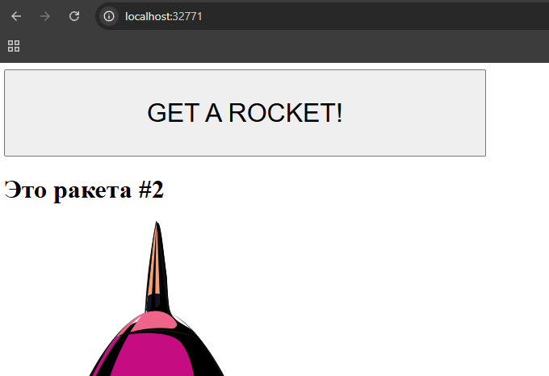</img>


### Часть 4. Полное уничтожение стека
Применим:
```bash
docker compose down -v
```


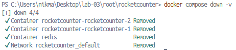</img>


Проверим:


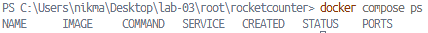</img>


## Ответы на вопросы:
1. Зачем в Ч.1 использовался `--link` и почему в Compose он не нужен?


- `--link` использовался вручную для настройки сетевого соединения и передачи данных о контейнере `redis` в контейнер приложения. В Compose это не нужно, так как он автоматически создает общую внутреннюю сеть, где сервисы могут обращаться друг к другу по имени через встроенный DNS.

2. Чем отличается `image` от `build` в Compose?


- `image` скачивает и использует уже готовый образ из реестра, а `build` указывает путь к локальной папке с `Dockerfile` для самостоятельной сборки образа перед запуском.

3. Почему нельзя масштабировать сервис с публикацией фиксированного порта на одном хосте? Перечислите способы обойти это ограничение.


- Порт хоста может быть занят только один раз. Способы обхода: использование динамических портов (`0:5000`), применение обратного прокси (`reverse proxy`, например `Nginx/Traefik`) в качестве единой точки входа, либо развертывание на разных узлах (`Docker Swarm/Kubernetes`).

4. Что делает `docker compose down -v` и чем отличается от `down` без `-v`?


- Обычный `down` останавливает и удаляет контейнеры и сети. Флаг `-v` дополнительно удаляет именованные тома, полностью стирая сохраненные в них данные.

5. Как в Compose обеспечивается сетевое имя сервиса для обращения из другого сервиса?


- Docker Compose автоматически создает отдельную мостовую сеть для стека и встроенный DNS-сервер. Ключ сервиса автоматически становится сетевым хост-именем, доступным для остальных контейнеров сети.

