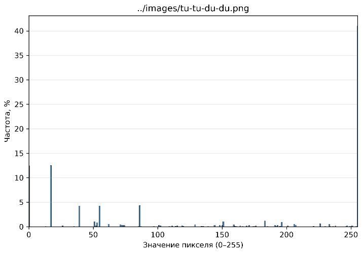
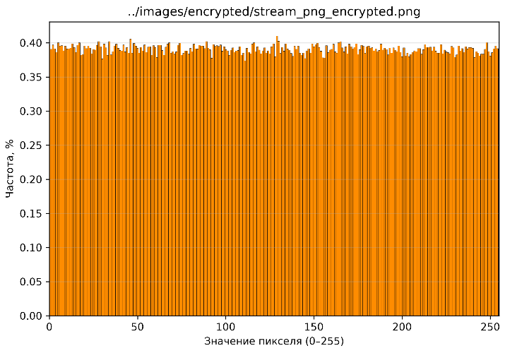
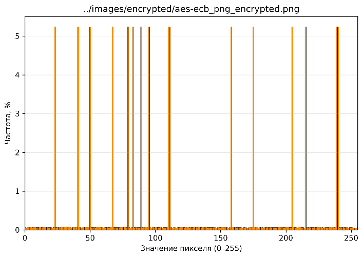
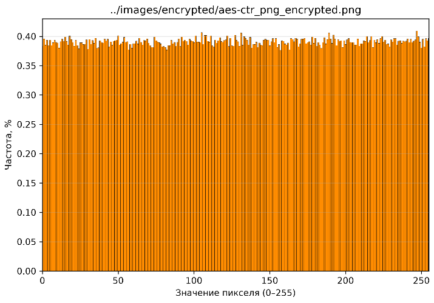

# Отчёт по первой лабораторной работе.
## 1.Постановка задачи

Были реализованы методы:
- Потоковые `Xorshift32`, `AES-CTR`
- Блочный `AES-ECB`

Используемые изображения:
- `gradient.png`
- `tu-tu-du-du.png`

Сравнение методов проводилось по следующим метрикам:
- Энтропия распределения значений пикселей
- Корреляция соседних пикселей
- Гистограмма значений

---

## 2.Реализация
### Потоковый `Xorshift32`.
Файл `stream_encryption.py`. Для генерации ключевого потока был реализован класс генератор псевдослучайных чисел `Xorshift32`,
требующий при инициализации начального состояния `seed` типа Integer, на который в дальнейшем накладывается 32 битная маска.
```python
class Xorshift32:
    def __init__(self, seed: int):
        self.state = seed & 0xFFFFFFFF
        if self.state == 0:
            self.state = 1

    def next_byte(self):...
```

Для шифрования используется функция `encrypt_decrypt_image`, где для каждого байта данных применяется `xor` с последующим в ключевом потоке элементом.
```python
def encrypt_decrypt_image(input_file, output_file, seed):...
```
### Блочный `AES-ECB`
Файл `encrypt-aes.py`. Была использована стандартная библиотека `cryptography`, реализующая класс `Cipher` с методами encryptor и `decryptor`. Для паддинга использовался стандарт `PKCS7`.
Методы `encrypt_aes_ecb` и `decrypt_aes_ecb` реализуют шифрование и дешифрование соответственно.

```python
        cipher = Cipher(algorithms.AES(key), modes.ECB(), backend=default_backend())
        encryptor = cipher.encryptor()
        ciphertext = encryptor.update(padded_data) + encryptor.finalize()
```
Также при шифровании создается файл с метаданными для хранения добавленных элементов и длинны байт данных исходного изображения для удобства генерации зашифрованной картинки.
```python
        meta = {
            "source": input_file,
            "padding": ciphertext[original_len:].hex(),
            "original_len": original_len
        }
```
### Потоковый `AES-CTR`
Файл `encrypt-aes.py`. Реализация схожа с методом `aes-ecb`, но теперь при инициализации объекта класса `Cipher` в аргументах при выборе режима требуется указать `nonce`,
который задается в `meta.json` либо генерируется программой,

```python
cipher = Cipher(algorithms.AES(key), modes.CTR(nonce), backend=default_backend())
```
и в метаданных шифрования уже будет храниться только оно.
```python
        meta = {
            "source": input_file,
            "nonce": base64.b64encode(nonce).decode('utf-8')
        }
```
### Проверка обратимости
Для проверки обратимости был реализован класс `SHAChecker` (`SHAChecker.py`), сохраняющий и обрабатывающий (`new_data`) байты данных для последующего сравнения хэшей (`compare_bytes_sha256`).
```python
class SHAChecker:
    def __init__(self, bytes_data1, bytes_data2):
        self.data1 = bytes_data1
        self.data2 = bytes_data2
        self.hash1 = hashlib.sha256(bytes_data1).hexdigest()
        self.hash2 = hashlib.sha256(bytes_data2).hexdigest()

    def compare_bytes_sha256(self):
        if self.hash1 == self.hash2:
            return True
        else:
            return False
```

---

## 3.Методика эксперимента
Файл `metrics.py`
Основное статистическое сравнение проводилось для изображения `"tu-tu-du-du.png"`.
Был выполнен расчет энтропии (`calculate_entropy`) и корреляции (`calculate_pixel_correlation`). Корреляция измерялась по всем пикселям изображения.
```python
def test_image(image_path: str):
    if os.path.isfile(image_path):
        parser = PNGParser(image_path)
        data = parser.get_raw_data()
        entropy = calculate_entropy(data)
        pixel_correlation = calculate_pixel_correlation(data, parser.get_width(), parser.get_height())
        return dict(entropy=entropy, pixel_correlation=pixel_correlation)
    else:
        raise FileNotFoundError(f"Файл по пути {image_path} не найден")
```
Эксперимент с изменением ключа проводиться отдельно. файл `key_sensitivity.py`. То-есть изображение `"source"` шифруется заново два раза с разными ключами. Ключи имеют различие в младшем байте. Для метода `AES-CTR` при тесте используется один и тот же `nonce`.
Для полученных зашифрованных изображений были посчитаны `NPCR` и `UACI`.
```python
def calculate_npcr_uaci(data1: bytes, data2: bytes):
    n = len(data1)
    diff_count = 0
    sum_abs_diff = 0

    for b1, b2 in zip(data1, data2):
        if b1 != b2:
            diff_count += 1
        sum_abs_diff += abs(b1 - b2)
    npcr = (diff_count / n) * 100.0
    uaci = (sum_abs_diff / (255.0 * n)) * 100.0

    return npcr, uaci
```
## 4.Результаты
### Сводная таблица метрик
Сводная таблица метрик для изображения `"tu-tu-du-du.png"`:
| Метод                | Энтропия           | Corr H                | Corr V                | Особенности                                                 |
| -------------------- | ------------------ | --------------------- | --------------------- | ----------------------------------------------------------- |
| Исходное             | 0.7477700978393395 | 0.4094680585192774    | 0.1357705469914044    | Исходное изображение легенды без структурных особенностей   |
|Потоковый `Xorshift32`| 7.999828957769077  | 0.0010524168955789491 | 3.103510356572068e-05 | Исходная структура изображения не сохранилась, шум          |
|`AES-ECB`             | 5.269065523137627  | -0.22979296046885628  | 0.6844839434664655    | Структура изменилась, прослеживаются контуры цветовых полей |
|`AES-CTR`             | 7.999833763293649  | -0.00197883863473279  | 0.0014835908790071539 | Как и в случае с `xorshift` просто цветовой шум             |

### Результаты шифрования


</img>
</img>
</img>
</img>


### Проверка обратимости
Для `xorshift32`:
```
Проверка обратимости:
Исходник:        741feaefd46a58aba3a96cbfc56c984be40796eddf740a1472ae636963108545
Восстановленный: 741feaefd46a58aba3a96cbfc56c984be40796eddf740a1472ae636963108545
Изображения совпадают по SHA256
```
Для `aes-ecb`:
```
Проверка обратимости:
Исходник:        741feaefd46a58aba3a96cbfc56c984be40796eddf740a1472ae636963108545
Восстановленный: 741feaefd46a58aba3a96cbfc56c984be40796eddf740a1472ae636963108545
Изображения совпадают по SHA256
```
Для `aes-ctr`:
```
Проверка обратимости:
Исходник:        741feaefd46a58aba3a96cbfc56c984be40796eddf740a1472ae636963108545
Восстановленный: 741feaefd46a58aba3a96cbfc56c984be40796eddf740a1472ae636963108545
Изображения совпадают по SHA256
```
Как можно заметить, хэши совпадают у всех вариантов изображений.


### Эксперимент с изменение ключа/`seed`

Эксперимент с изменение сида для алгоритма `xorshift32`. Был изменен последний символ в сиде:
```
Seed 1: 1234567890
Seed 2: 1234567891
```
Результаты теста
```
NPCR = 99.6040%
UACI = 33.4536%
```
Эксперимент с изменение ключа для алгоритма `aes-ecb`. Был изменен младший байт в ключе:
```
Ключ 1: b'\x08\xf8y\x9c\x04\x94\x83ZN\x82m\x0fg\xa1\x1c\xaf\x1b\xb2\x98\x12\x99\x8d0-\xa0B\x0e\x90\x0f\x00\xeej'
Ключ 2: b'\t\xf8y\x9c\x04\x94\x83ZN\x82m\x0fg\xa1\x1c\xaf\x1b\xb2\x98\x12\x99\x8d0-\xa0B\x0e\x90\x0f\x00\xeej'
```
Результаты теста
```
NPCR = 99.9281%
UACI = 27.1537%
```
Эксперимент с изменение ключа для алгоритма `aes-ctr`. Был изменен младший байт в ключе:
```
nonce = b'\xebX\xa8I\xa0\x8b\x15\x94\xd1\xddF{\x1f\x0e\x9aA'
Ключ 1: b'\xbb\xc6\x8c\xcdM4^\xb0/\x98\xc3\x059G\xa4\x1b\x8cG[{\x1a?\xc9v\xca\x16\xc9\xc1\xaa\x9d\xa6\xa5'
Ключ 2: b'\xba\xc6\x8c\xcdM4^\xb0/\x98\xc3\x059G\xa4\x1b\x8cG[{\x1a?\xc9v\xca\x16\xc9\xc1\xaa\x9d\xa6\xa5'
```
Результаты теста
```
NPCR = 99.6157%
UACI = 33.4482%
```


## 5.Анализ
Сравнивая исследованные методы шифрования (`Xorshift32`, `AES-CTR` и `AES-ECB`) на основе полученных численных показателей и графических данных, можно сделать следующие выводы:
- Наилучшие результаты по корреляции показали потоковые алгоритмы `Xorshift32` и `AES-CTR` (например, вертикальная корреляция `AES-CTR` составляет `~ 0.00148`, а горизонтальная `~ -0.00198`.
  Это свидетельствует об успешном разрушении статистической зависимости между соседними пикселями.
- Энтропия исходного изображения составляет всего `~ 0.748` из-за однородных цветовых полей. Потоковые алгоритмы `Xorshift32` и `AES-CTR` имеют значение энтропии сильно большую `~ 7.9998`,
   что говорит о равномерном распределении значений пикселей в шуме. У `AES-ECB` энтропия значительно ниже `~ 5.269`.
- Главное отличие `AES-ECB` от `AES-CTR` заключается в том, что одинаковые блоки данных всегда шифруются в одинаковые блоки зашифрованных данных независимо от их позиции. Из-за этого на зашифрованном изображении проступают контуры и структура исходных цветовых полей.
  Режимы с ключевым потоком (`Xorshift32` и `AES-CTR`) меняют каждый байт индивидуально в зависимости от позиции или счетчика (`nonce`), полностью разрушая исходную структуру.
- Полученные гистограммы и изображения полностью подтверждают друг друга. Для `Xorshift32` и `AES-CTR` гистограммы выглядят как равномерно распределенный шум, а картинка представляет собой цветовой шум.
 Для `AES-ECB` на гистограмме и изображении четко прослеживаются следы исходного контура, что напрямую связано с более низкой энтропией и высокой вертикальной корреляцией.

## 6.Итоговый вывод
Реализованные методы шифрования показали полную работоспособность (совпадение хэшей по `SHA256`). `Xorshift32` и `AES-CTR` статестически показали себя хорошо. `AES-ECB` по метрикам сильно уступаем им. Более стойким к взлому остается `AES-CTR`, так как в шифровании используется дополнительное единоразовый псевдослучайный `nonce`, `xorshift` менее устойчив из-за использования одного seed в 32 бита, а `AES-ECB` детерминирован.
