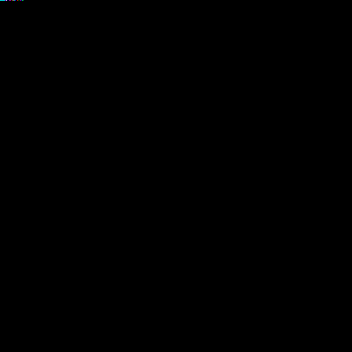
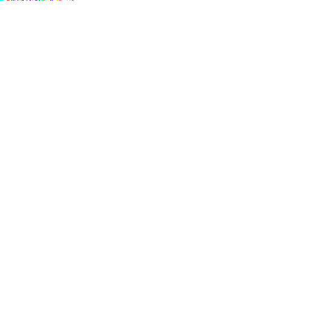
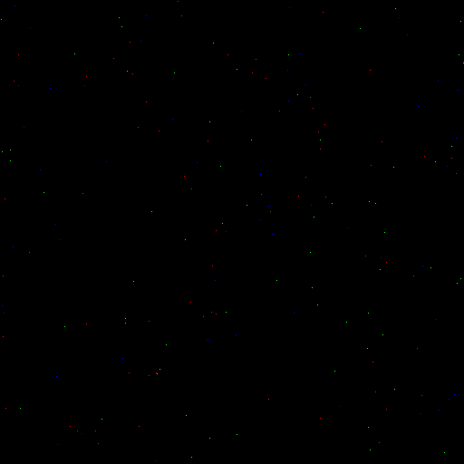
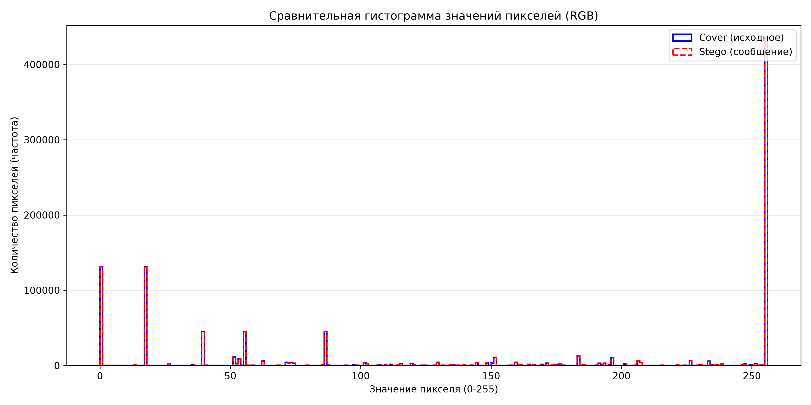

# Отчёт по второй лабораторной работе.

## 1.Постановка задачи

Были реализованы встраивания:
- Простое `LSB`-встраивание
- Шифрование сообщения методом `AES-GСM` + `LSB`-встраивание
- Шифрование сообщения методом `AES-GСM` + генерация псевдослучайных позиций + `LSB`-встраивание

Используемые изображения:
- `gradient.png`
- `tu-tu-du-du.png`

Сообщение: `Hello, World!`

---

## 2.Реализация
### `LSB` -встраивание
Файл `PlainLSB`. Во всех вариантах встраивания используется парсер png изображения (`PNGParser`), основанный на библиотеке `PyPNG`. Парсер имеет функцию `get_pixels()`,
```python
    def get_pixels(self):
        return self.pixels
```

которая возвращает массив вида: `[R, G, B, R, G, B, ...]` (для `RGB`), где каждое число (канал) изменяется путем:

```python

pixels[i] = (pixels[i] & 0xFE) | int(bit)

```

в функции `embed_message_in_pixels`, там же проверяется возможность встраивания сообщения.
```python
    if len(bitstream) > len(pixels):
        raise ValueError(
            f"Сообщение не помещается: нужно {len(bitstream)} бит, "
            f"доступно {len(pixels)} бит (макс. {len(pixels) // 8 - 4} байт)"
        )

```

А битовый поток текста перед этим получается в выводе функции `text_to_bitstream` (файл `TextParser`),
```python
def text_to_bitstream(text: str):
    data = text.encode('utf-8')
    length = len(data)

    if length > 0xFFFFFFFF:
        raise ValueError("Текст слишком длинный")

    payload = length.to_bytes(4, byteorder='big') + data

    return ''.join(f'{byte:08b}' for byte in payload)
```

которая уже совмещает байты `[длина][сообщение]`. Длина сохраняется в 32 битном значении.

В данном варианте пиксели изображения изменяются последовательно.

### Шифрование сообщения методом `AES-GСM` + `LSB`-встраивание

Файл `EncryptedLSB`. Реализация схожа с обычным `LSB`, но уже перед получением битового потока и встраиванием сообщение подвергается шифрованию методом `AES-GCM` с использованием `salt` и `nonce` (генерируются в функциях шифрования)(в тестах на чуствительность к объему `payload` фиксированные `salt` и `nonce`),

```python
    key = derive_key(password, salt)
    aes_gcm = AESGCM(key)
    ciphertext = aes_gcm.encrypt(nonce, text.encode('utf-8'), None)
```

ключ с `salt` формируется методом `PBKDF2HMAC`.
```python
def derive_key(password: str, salt: bytes):
    kdf = PBKDF2HMAC(
        algorithm=hashes.SHA256(),
        length=KEY_SIZE,
        salt=salt,
        iterations=100_000,
    )
    return kdf.derive(password.encode('utf-8'))
```
 Также потребовалось реализовать функцию `bytes_to_bistream` в `TextParser`. Итоговый payload имеет структуру `[длина][salt][nonce][сообщение]`.
```python
    payload = length_payload.to_bytes(4, 'big') + salt + nonce + ciphertext
```


### Шифрование сообщения методом `AES-GСM` + генерация псевдослучайных позиций + `LSB`-встраивание

Файл `EncryptedRandomLSB`. Реализация схожа с `AES-GCM` + `LSB`, но теперь встраивание `payload` происходит не последовательным обходом пикселей изображения, а генераций набора позиций (`get_shuffled_indices`). Набор позиций детерминирован, для генерации используется пароль.
```python
def get_shuffled_indices(count_pixels: int, password: str):
    seed_bytes = hashlib.sha256(password.encode('utf-8')).digest()
    seed_int = int.from_bytes(seed_bytes[:4], 'big')
    rng = random.Random(seed_int)
    indices = list(range(count_pixels))
    rng.shuffle(indices)
    return indices
```


## 3.Методика эксперимента

Основные сравнения проводились для изображения `"tu-tu-du-du.png"`. Файл `Metrics.py`.

Были расчитаны метрики:

`PSNR` - (Peak Signal-to-Noise Ratio — пиковое отношение сигнала к шуму) используется как метрика для количественной оценки искажений, которые появляются в исходном носителе после внедрения скрытого сообщения.

`SSIM` - (Structural Similarity Index Measure Индекс структурного сходства) используется для оценки незаметности внедрения данных.

Доля изменённых компонент

Распределение `LSB`- описывает то, как меняются или распределяются младшие биты в байтах данных контейнера при скрытии информации.

`χ²`-анализ - используется для обнаружения скрытых сообщений в цифровых контейнерах.

Влияние объёма данных


При тестировании на чувствительность к объему использовались `1%` и `5%` данных от возможного объема.


## 4.Результаты

Первый тест (сообщение `"Hello, World!"`, password `1234`):

| Вариант              | PSNR              | SSIM               | Changed ratio | P(LSB)=1           | Xi²               | p-value |
| -------------------- | ----------------- | ------------------ | ------------- | -----------------  | ----------------- | ------- |
| Plain LSB            | 90.07605471446708 | 0.9999998630690203 | 0.006%        | 0.7455596923828125 | 931850.6216928256 | 0.0     |
| Encrypted LSB        | 84.64464416737391 | 0.9999994112227963 | 0.022%        | 0.7454843521118164 | 930917.2513061255 | 0.0     |
| Encrypted Random LSB | 84.28846557527595 | 0.999996544503702  | 0.024%        | 0.7454710006713867 | 930944.189790851  | 0.0     |

Второй тест на чувствительность к объему (сообщение генерируется автоматически)

| Вариант                 | PSNR              | SSIM               | Changed ratio | p-value |
| ----------------------- | ----------------- | ------------------ | ------------- | ------  |
| Plain LSB 1%            | 72.32163490497524 | 0.999973742923039  | 0.380%        | 0.0     |
| Plain LSB 5%            | 65.3160922049746  | 0.9997705601957702 | 1.911%        | 0.0     |
| Encrypted LSB 1%        | 71.03382612050385 | 0.9999454603766772 | 0.512%        | 0.0     |
| Encrypted LSB 5%        | 64.13048015813413 | 0.9994305485666211 | 2.512%        | 0.0     |
| Encrypted Random LSB 1% | 70.97762157616236 | 0.9999255256583085 | 0.519%        | 0.0     |
| Encrypted Random LSB 5% | 64.12916136675743 | 0.9996345819341899 | 2.512%        | 0.0     |

Карты разности:


</img>
</img>
</img>

Гистограммы (синие - исходное изображение, красные - со встроенным сообщением):


</img>
</img>
</img>


## 5. Анализ
- Наивысшие показатели PSNR и SSIM демонстрирует Plain LSB (PSNR > 90 дБ для выбранного). Это может быть связано с тем, что в него встраивается только исходный текст. Методы с шифрованием Encrypted LSB и Encrypted Random LSB имеют более низкий PSNR (~ 84 дБ), из-за добавления salt и вектора инициализации nonce. Показатели SSIM для всех близки к 1.0, что говорит о том, что структурная целостность изображения не нарушается.
- Доля измененных компонент напрямую зависит от объема встраиваемого payload. Для Plain LSB она 0.006%, для Encrypted LSB - 0.022%, а для Encrypted Random LSB - 0.024%. В тесте на чувствительность видно, что при увеличении заполнения с 1% до 5% доля измененных компонент растет практически пропорционально.
- Значение χ2 для всех стего-изображений остается большим (~ 930 000), а p-value равно 0.0.
- Шифрование увеличивает долю измененных компонент, что немного ухудшает PSNR. AES-GCM превращает сообщение в псевдослучайный поток.
- Псевдослучайное размещение Random LSB незначительно уменьшает PSNR и увеличивает долю измененных пикселей, но его главное преимущество не в визуальных метриках, а в безопасности: оно распределяет изменения по всему изображению.
- При увеличении объема скрываемых данных с 1% до 5%: показатель PSNR заметно падает, так как в изображение вносится больше шума. SSIM снижается незначительно. Значение p-value остается нулевым.
- По картам разности можно увидеть, что в PlainLSB и EncryptedLSB сообщение встраивается последовательно, целым куском, а в RandomEncryptedLSB оно раскидано по всему изображению. Также по гистограммам можно заметить, что небольшое сообщение совершенно не заметно влияет на якростные показатели.

## 6. Вывод
В ходе работы были реализованы и исследованы три метода стеганографии. Эксперимент показал, что все три метода обеспечивают высокую визуальную незаметность, не внося заметных искажений даже при заполнении емкости изображения на 5%.
Добавление шифрования AES-GCM увеличивает размер встраиваемых данных за счет служебных полей (salt, nonce), что немного снижает PSNR. xi² анализ по парам не показал сильных отличий между оригинальным изображением и stego-изображением при малых нагрузках.

